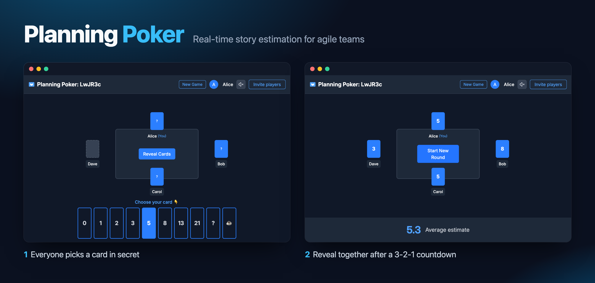
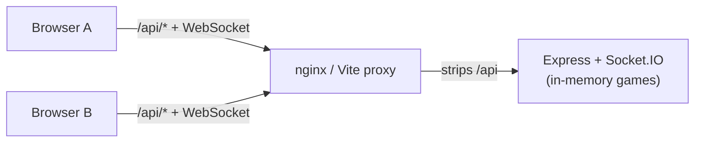

# Planning Poker



A real-time planning poker app for agile teams. Create a room, share the invite link, everyone votes in secret, and the cards are revealed for all players at once.

## Features

- **No sign-up.** Enter a name, create a game, and share the invite link (copied with one click).
- **Secret voting.** Cards are `0 1 2 3 5 8 13 21 ? ☕`. Other players see *that* you voted, not *what* you voted.
- **Reveal together.** Any player starts a 3-2-1 countdown, then every card is shown to everyone.
- **Average estimate.** Calculated from numeric cards only; `?` and `☕` are ignored.
- **New rounds.** One click clears all cards for everyone.
- **Reconnect-friendly.** Reloading the page rejoins the game under the same name, without a duplicate seat.
- **Theme music** while votes come in. It can be muted, and the setting is remembered.
- **Zero persistence.** Games live in memory. A game is removed when its last player leaves, or after one hour.

## Quick start

### Docker

```bash
docker compose up --build
```

Open http://localhost:3000.

### Local development

Requires Node.js 22.22+ (the Docker images use Node 26).

```bash
npm run install-all
```

```bash
npm run dev
```

The client runs on http://localhost:3000 with hot reload. The API and WebSocket server runs on http://localhost:8000. Vite forwards `/api/*` to the server, just like nginx does in Docker.

## Scripts

Run these from the repository root.

| Script | Description |
| --- | --- |
| `npm run install-all` | Install dependencies for root, server and client |
| `npm run dev` | Start server (`node --watch`) and client (Vite) together |
| `npm run build` | Type-check and build the client into `client/dist` |
| `npm start` | Start the server only |
| `npm test` | Server and client unit tests |
| `npm run test:e2e` | End-to-end tests in Chromium against the production build |
| `npm run test:all` | Everything above. Run this after every dependency update |
| `npm run screenshot` | Regenerate `docs/header.png` from a live 4-player round |
| `npm run release -- 1.2.0` | Set the version everywhere, commit and tag `v1.2.0` (see [Releases](#releases)) |

Inside `client/`, `npm run lint` runs ESLint.

## Testing

The test suite guards the app against breaking dependency updates. Each layer runs real multi-user scenarios:

| Layer | Tooling | What it covers |
| --- | --- | --- |
| Server | `node:test` + `socket.io-client` | REST API, average calculation, card hiding, and two socket clients playing full rounds (join, vote, countdown, reveal, new round, leave, rejoin, error cases) |
| Client | Vitest + Testing Library (jsdom) | Home page forms and validation, invite links, and every game-room state (via a fake socket): voting, countdown, reveal, new round, sound toggle, invite copy |
| End-to-end | Playwright | Two or more **independent users** (separate browser contexts with their own storage and connection) playing through every use case against the built app and the real server |

Before the first end-to-end run, download the browser:

```bash
npx playwright install chromium
```

```bash
npm run test:all
```

Playwright starts the server and `vite preview` on its own. Locally it reuses them if they are already running.

## How it works



Clients create and check games over REST. Everything else goes over Socket.IO, under the path `/api/socket.io`. The server sends each player a personalised state: your own card is visible to you, while other players' cards stay hidden (`true`) until the reveal.

**REST**

| Method | Path | Response |
| --- | --- | --- |
| `POST` | `/games` | `{ gameId }`, a new 6-character id |
| `GET` | `/games/:gameId` | Current game state, or `404` |
| `GET` | `/health` | `{ status: "ok" }` |

**Socket events**

| Client → server | Payload | Effect |
| --- | --- | --- |
| `join-game` | `{ gameId, playerName }` | Join, or rejoin and replace a seat with the same name |
| `select-card` | `{ card }` | Vote or change your vote |
| `start-countdown` | none | Countdown 3-2-1 for everyone, then reveal |
| `new-round` | none | Clear all cards and the reveal |

The server answers every change with `game-updated` (the game state) or `error` (`{ message }`).

## Project structure

```
├── client/                 React 19 + Vite 8 + Tailwind CSS 4 (TypeScript)
│   ├── src/pages/          HomePage, GameRoom (+ *.test.tsx)
│   ├── nginx.*.conf        nginx config per DEPLOYMENT_ENV (picked at start)
│   └── Dockerfile          build → static files served by nginx
├── server/                 Express 5 + Socket.IO 4 (Node.js)
│   ├── index.js            REST API, socket events, in-memory store
│   └── index.test.js
├── e2e/                    Playwright end-to-end tests
├── scripts/                release script, README header screenshot
├── .github/workflows/      CI: tests, GHCR images, GitHub release
├── docker-compose.yaml     local stack (nginx proxies /api to the backend)
└── docker-compose.coolify.yaml
```

## Releases

[](https://github.com/moinahoi/planningpoker/actions/workflows/ci.yml)

Versions follow [SemVer](https://semver.org). The git tag `vX.Y.Z` is the single source of truth. The version appears in the bottom-right corner of the app and in the server's `/health` response.

```bash
npm run release -- 1.2.0
```

```bash
git push --follow-tags
```

The [CI workflow](.github/workflows/ci.yml) runs on every push and pull request: lint, unit tests and end-to-end tests, with the Docker builds running in parallel. For a `v*` tag it also:

1. checks that the tag matches all `package.json` versions,
2. builds `linux/amd64` images with the version baked in and stages them in GHCR as `sha-<commit>`,
3. once all tests pass, tags the staged images as `1.2.0`, `1.2`, `1` and `latest`, without rebuilding them:
   - `ghcr.io/moinahoi/planningpoker-server`
   - `ghcr.io/moinahoi/planningpoker-client`
4. creates the [GitHub release](https://github.com/moinahoi/planningpoker/releases) with generated notes.

## Deployment

- **`docker-compose.yaml`** builds both images locally. The client container runs with `DEPLOYMENT_ENV=localhost`, so nginx proxies `/api/*` to the backend.
- **`docker-compose.coolify.yaml`** runs the prebuilt GHCR images, so Coolify no longer builds anything. Set `APP_VERSION` (e.g. `1.2.0`) in Coolify to pin a release, or leave it empty for `latest`. With `DEPLOYMENT_ENV=production`, nginx only serves static files, so Coolify's proxy must route `/api/*` to the backend on port 8000 and strip the `/api` prefix.

The client image picks `client/nginx.$DEPLOYMENT_ENV.conf` at container start, so one image serves both setups. The server keeps all games in memory, so run a single backend instance.

## License

MIT
